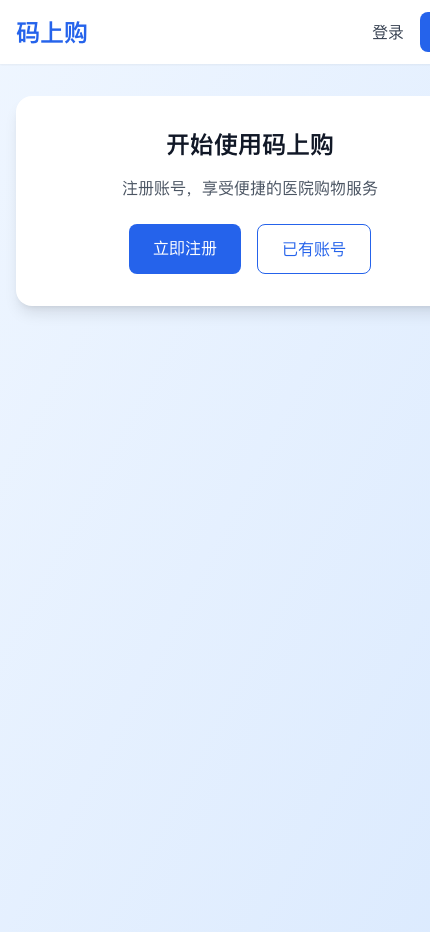
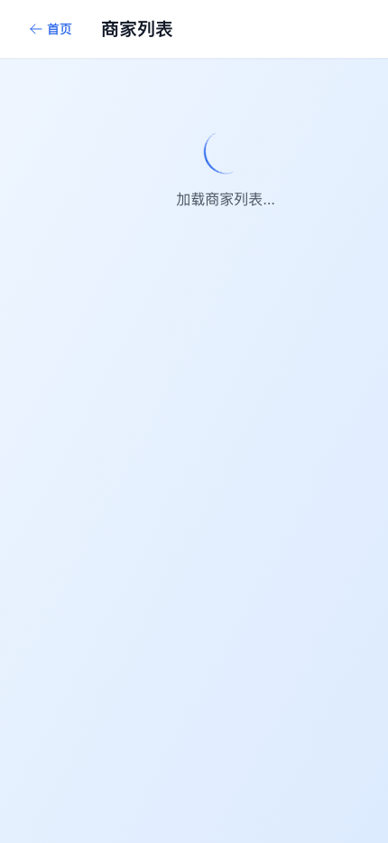
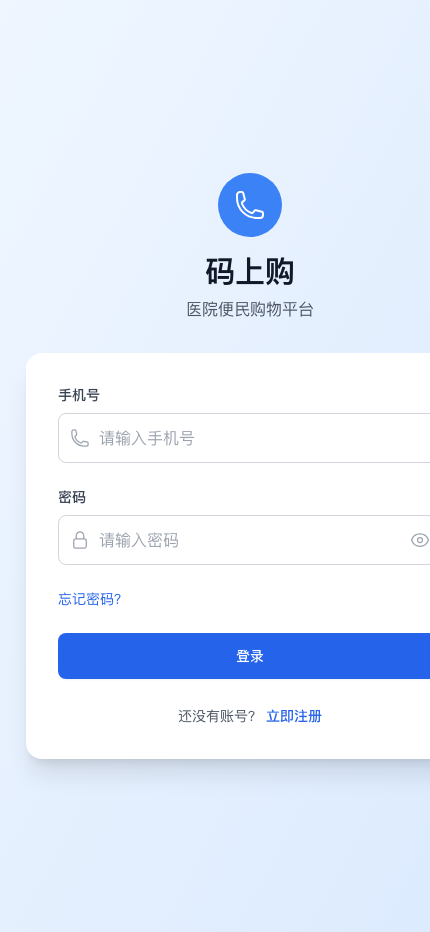
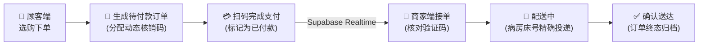

# 🏥 医疗便民订购平台 (Hospital Takeaway PWA)

<p align="center">
  <b>A Healthcare-Oriented Ordering PWA for Clinical & Hospital Scenarios</b><br>
  面向医疗与病房场景的便民订购渐进式 Web 应用 (PWA)
</p>

<p align="center">
  
  
  
  
  
  
  
</p>

<p align="center">
  
</p>

---

## 📱 实机运行截屏 (Live Screenshots)

| 🏥 便民订购首页 (Home) | 🍱 入驻商户列表 (Merchants) | 🔐 用户与角色登录 (Auth) |
| :---: | :---: | :---: |
|  |  |  |
| **病房全院公告与轮播**：支持病床精准配送、优惠活动与最近订单一键复购。 | **科室/餐厅分类列表**：商家营业状态标签、起送金额与床位专送承诺。 | **多端角色身份验证**：患者、陪护家属、入驻商家与总管理员分离登录。 |

---

## 📖 项目简介 (Overview)

**医疗便民订购平台 (Hospital Takeaway)** 是专为住院患者、陪护家属及医护人员设计的轻量级医疗便民餐饮与日用品订购平台。

系统针对医院病房信号不稳定、病患行动受限等痛点，采用 **PWA (Progressive Web App)** 架构，支持手机桌面一键添加与离线缓存；后端依托 **Supabase (PostgreSQL + Realtime + RLS)** 实现全链路实时订单订阅、智能库存扣减及多角色权限隔离。

---

## 🛠️ 基于源码的核心功能架构 (Code Grounding)

系统完全由源代码定义，分为三大角色工作台：

### 1. 顾客端 (`src/pages/customer/`)
- **病床精准配送**：录入住院楼栋、病区科室与床位号，订单直达病榻；
- **购物车与优惠抵扣 (`cartStore.ts`)**：支持单品满减、全店折抵与库存强校验；
- **核销码与扫码支付**：支持线下扫商户收款码并提交核销码，防止错付漏付；
- **订单超时防沉没 (`utils/orderTimeout.ts`)**：30 分钟未标记支付自动归档释放库存。

### 2. 商家端 (`src/pages/merchant/`)
- **接单与状态机流转 (`OrderManagement.tsx`)**：接单 → 备餐/备货 → 病区配送中 → 确认核销；
- **菜品与实时库存 (`MenuManagement.tsx`)**：菜品分类录入、库存预警与一键售罄下架；
- **营销活动管理 (`PromotionManagement.tsx`)**：配置限时特惠与阶梯满减；
- **财务与收款码 (`PaymentManagement.tsx`)**：上传微信/支付宝商户收款码。

### 3. 总管控制台 (`src/pages/super-admin/`)
- **商户入驻资质核验 (`MerchantManagement.tsx`)**：卫生资质审查与上架授权；
- **全院公告与轮播发布 (`ContentManagement.tsx`)**：实时向全院端广播就餐提醒与安全指引；
- **平台全域数据统计 (`Analytics.tsx`)**：各商户履约率、日流水与退单分析。

---

## 🔄 核心业务流转 (Order Lifecycle)



---

## 📦 项目代码结构 (Directory Structure)

```text
hospital-takeaway/
├── assets/screenshots/      # 从实机运行环境中抓取的真实 UI 截屏
├── src/
│   ├── components/ui/       # 基础组件 (Card, Modal, StatusBadge, ImageUpload)
│   ├── contexts/            # 认证上下文 (AuthContext) 与智能导航 (NavigationContext)
│   ├── stores/              # Zustand 状态管理 (cartStore)
│   ├── utils/               # 订单超时取消策略 (orderTimeout.ts)
│   ├── pages/               # 顾客端、商家端、总管控制台路由组件
│   └── lib/                 # Supabase 客户端配置与实时通道监听
├── supabase/migrations/     # 包含 RLS 策略的完整 PostgreSQL 迁移脚本
└── public/                  # PWA Manifest 与离线图标
```

---

## 🚀 快速开始 (Quickstart)

### 1. 安装依赖与环境配置

```bash
git clone https://github.com/Evan-Joseph/hospital-takeaway.git
cd hospital-takeaway
pnpm install
```

复制环境变量配置：
```bash
cp .env.example .env
```

配置你的 Supabase 凭据：
```env
VITE_SUPABASE_URL=https://your-project.supabase.co
VITE_SUPABASE_ANON_KEY=your_supabase_anon_key
```

### 2. 启动开发与预览

```bash
# 启动本地开发服务
pnpm dev

# 生产环境构建与预览
pnpm build
pnpm preview
```

在浏览器打开 `http://localhost:5173` 即可体验。

---

## 📄 开源许可证 (License)

本项目采用 [MIT License](LICENSE) 开源。
