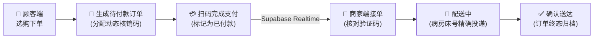

# 🏥 Hospital Takeaway (码上购)

<p align="center">
  <b>A Healthcare-Oriented Ordering PWA for Clinical & Hospital Scenarios</b><br>
  面向医疗与病房场景的便民订购渐进式 Web 应用 (PWA)
</p>

<p align="center">
  
  
  
  
  
  
  
</p>


<p align="center">
  
</p>

---

## 📖 项目简介 (Overview)

**Hospital Takeaway (码上购)** 是专为住院患者、陪护家属及医护人员设计的轻量级医疗便民餐饮与日用品订购平台。

系统针对医院病房信号不稳定、病患行动受限等痛点，采用 **PWA (Progressive Web App)** 架构，支持手机桌面一键添加与离线缓存；后端依托 **Supabase (PostgreSQL + Realtime + RLS)** 实现全链路实时订单订阅、智能库存扣减及多角色权限隔离。

---

## 🌟 核心特性 (Key Features)

- **📱 PWA 离线支持**：基于 Service Worker 实现核心静态资源与商品缓存，弱网或无网络环境下依然支持快速加载与本地桌面添加到屏。
- **👥 三角色协同体系**：
  - **顾客端 (Patient/Family)**：病床号定位、商品分类检索、购物车、优惠券抵扣、扫码核销码支付。
  - **商家端 (Merchant)**：菜品与库存实时管理、新订单声波/桌面实时提醒、状态流转操作台、出货统计。
  - **管理端 (Admin)**：入驻商户资质审核、轮播公告配置、平台日结流水与履约监控。
- **⚡ 实时订单流转**：通过 Supabase Realtime Channels 建立长连接，订单状态秒级同步，告别客户端轮询。
- **🔒 细粒度安全访问 (RLS)**：PostgreSQL 行级安全策略严格限制各角色数据读写边界，保障患者隐私与财务数据安全。

---

## 🔄 核心业务流转 (Order Lifecycle)



---

## 🛠️ 技术栈 (Tech Stack)

| 层次 | 技术选型 | 说明 |
|---|---|---|
| **前端框架** | React 18 + Vite 5 | SPA 快速构建与热更新 |
| **语言与规范** | TypeScript 5.5 + ESLint | 全局静态类型检查 |
| **界面与样式** | Tailwind CSS + Lucide Icons + Sonner | 实用优先响应式布局与优雅通知吐司 |
| **状态管理** | Zustand | 轻量级全局认证与购物车状态驱动 |
| **后端云服务** | Supabase (PostgreSQL 15) | 托管数据库、JWT 鉴权、文件存储与 Realtime 事件流 |
| **PWA 原语** | `vite-plugin-pwa` + Workbox | 离线缓存策略与 Web App Manifest |

---

## 📦 项目结构 (Directory Structure)

```text
hospital-takeaway/
├── src/
│   ├── components/          # 公共 UI 组件与页面布局骨架
│   │   ├── ui/              # 基础原子组件 (Buttons, Dialogs, Inputs)
│   │   └── layout/          # 顶部导航、底部 Tab 与角色侧边栏
│   ├── pages/               # 路由页面
│   │   ├── auth/            # 登录、注册与权限重定向
│   │   ├── customer/        # 顾客端主页、购物车与订单流
│   │   ├── merchant/        # 商家管理端操作台与商品录入
│   │   └── super-admin/     # 平台全域数据看板
│   ├── hooks/               # 自定义 React Hooks (订单监听、网络状态等)
│   ├── stores/              # Zustand 状态存储 (cartStore, authStore)
│   └── lib/                 # Supabase Client 初始化与工具库
├── supabase/
│   └── migrations/          # 完整的数据库迁移脚本与 RLS 策略
└── public/                  # PWA 图标与应用清单 (manifest.json)
```

---

## 🚀 快速开始 (Quickstart)

### 1. 环境准备

确保本机已安装：
- [Node.js](https://nodejs.org/) (>= 18.0.0)
- [pnpm](https://pnpm.io/) (推荐) 或 `npm`

### 2. 克隆与安装

```bash
git clone https://github.com/Evan-Joseph/hospital-takeaway.git
cd hospital-takeaway
pnpm install
```

### 3. 配置环境变量

复制环境变量模板：
```bash
cp .env.example .env
```

填入你的 Supabase 项目凭据：
```env
VITE_SUPABASE_URL=https://your-project.supabase.co
VITE_SUPABASE_ANON_KEY=your-anon-key-here
```

### 4. 数据库初始化

使用 Supabase CLI 执行数据库结构初始化与权限配置：
```bash
# 本地或远程重置数据库结构
supabase db push
# 或直接在 Supabase SQL Editor 中执行 supabase/migrations/ 目录下的 SQL 文件
```

### 5. 启动开发服务器

```bash
pnpm run dev
```

浏览器打开 `http://localhost:5173` 即可预览完整多端交互。

---

## 📊 核心数据库实体 (Database Schema)

- `user_profiles`: 用户基础扩展信息（角色分类：`customer`, `merchant`, `admin`）
- `merchants`: 入驻商户资料、营业执照、配送费用与收款码
- `products`: 菜品/物资分类、定价、实时库存及上下架状态
- `orders`: 订单主表（含病区、楼层、床位、核销码、金额及状态机）
- `order_items`: 订单行明细与规格参数
- `promotions`: 优惠券与满减规则引擎

---

## 📄 开源许可证 (License)

本项目采用 [MIT License](LICENSE) 开源。
