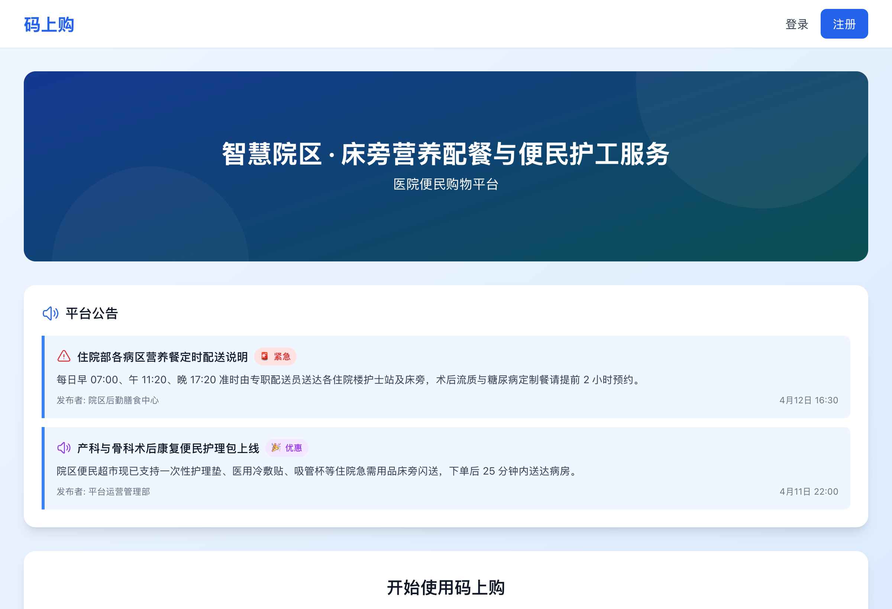
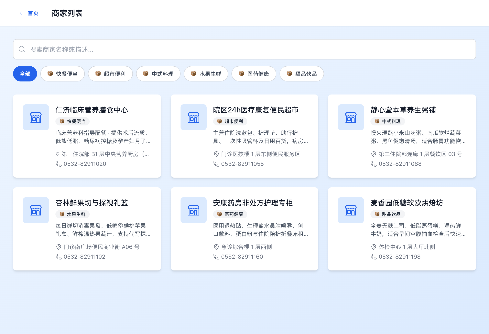
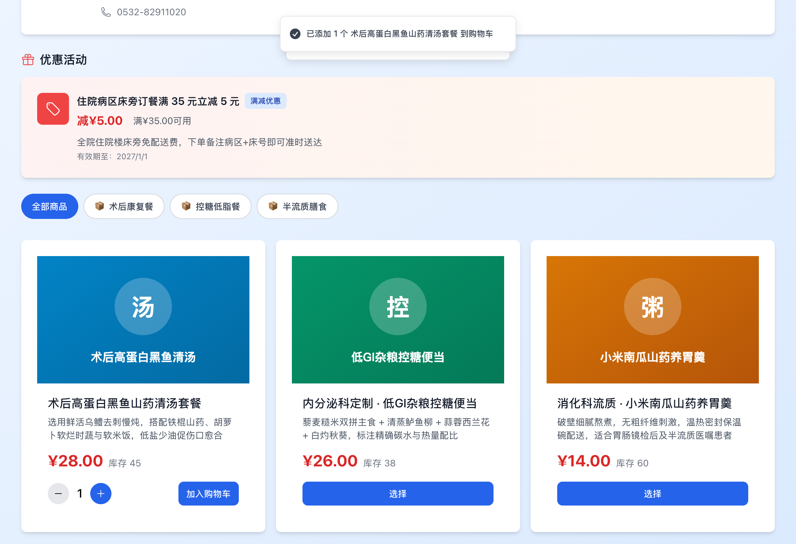
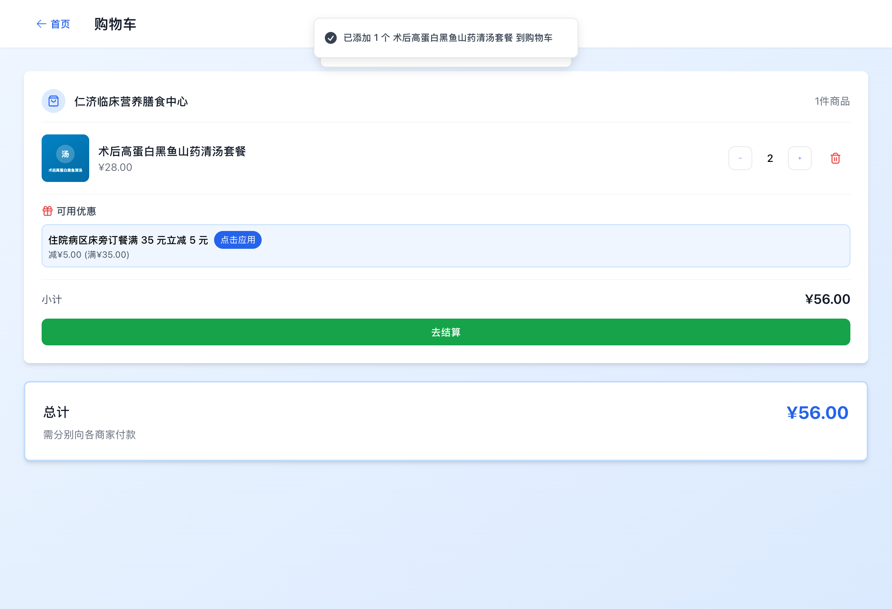

# 码上购 (Hospital Takeaway) — 院内营养配餐与便民服务平台

<p align="center">
  
  
  
  
  
</p>

<p align="center">
  
</p>

**码上购 (Hospital Takeaway)** 是面向住院患者、陪护家属与院内后勤商户的渐进式 Web 应用（PWA）。系统针对住院病区床旁营养配餐（术后流质、控糖低脂餐）、院内便民商超护理用品闪送及护工预约场景设计，基于 React 18、TypeScript、Zustand 与 Supabase 构建，包含顾客端、商户端与平台管理员端三套权限视图。

---

## 界面预览

<table>
  <tr>
    <td width="50%" align="center">
      
      <br />
      <sub><b>院内入驻商家名录</b>：按临床营养膳食、康复器械商超与陪护服务分类检索</sub>
    </td>
    <td width="50%" align="center">
      
      <br />
      <sub><b>商家菜单与优惠</b>：展示满减活动、医嘱膳食分类、实时库存与选品加购</sub>
    </td>
  </tr>
  <tr>
    <td width="50%" align="center">
      
      <br />
      <sub><b>首页与院区公告</b>：定时配餐批次通知、紧急公告置顶与快捷功能入口</sub>
    </td>
    <td width="50%" align="center">
      
      <br />
      <sub><b>购物车与满减核销</b>：支持按入驻商户自动拆单、优惠规则应用与床旁配送结算</sub>
    </td>
  </tr>
</table>

---

## 核心功能

### 1. 顾客端 (`src/pages/customer/`)
- **院区公告与商家检索**：首页轮播横幅、院区紧急公告提示、按名称/经营范围过滤入驻商家。
- **临床膳食与便民选品**：按商品分类浏览店铺菜单，查看实时库存与单品限购优惠，支持多商家购物车独立小计。
- **床旁地址与订单追踪**：维护病区楼号/床位收货地址，支持线下扫码支付搭配 4 位订单验证码核销，通过 Supabase Realtime 实时同步订单流转状态。

### 2. 商家端 (`src/pages/merchant/`)
- **商品与分类管理**：维护商品上下架、实时库存、套餐图片及店内分类（`MerchantProducts.tsx`、`MerchantCategories.tsx`）。
- **促销活动与收款码**：配置满减规则、单品折扣、活动有效期与店铺收款二维码（`MerchantPromotions.tsx`、`MerchantPaymentQR.tsx`）。
- **实时接单与核销**：接收新订单提醒，核对顾客支付验证码后执行确认收款与床旁派送（`MerchantOrders.tsx`）。

### 3. 超级管理员端 (`src/pages/super-admin/`)
- **商户审核与用户管理**：审核入驻商家资质、管理平台账户角色与状态（`Merchants.tsx`、`Users.tsx`）。
- **运营内容与数据统计**：配置首页轮播图（`Banners.tsx`）、发布全院公告（`Announcements.tsx`），统计各商户订单量与平台成交额（`Analytics.tsx`）。

---

## 订单状态流转

系统采用线下扫码支付结合订单验证码的轻量核销机制，核心状态机定义如下：

1. `pending_payment`（待支付）：顾客提交床旁配送订单，系统生成唯一订单号与 4 位支付验证码。
2. `customer_paid`（顾客已标记支付）：顾客扫描商户收款码并在备注填写验证码后，手动确认已完成付款（30 分钟未操作则触发 `timeout_closed` 超时关闭）。
3. `merchant_confirmed`（商家已确认收款）：商户核对收款记录与验证码后确认接单。
4. `delivering`（配送中）：配餐员或护工送往对应住院楼病区与床位。
5. `completed`（已确认收货）：顾客签收确认，订单归档。

---

## 技术架构与目录结构

| 模块 | 技术选型 | 说明 |
| :--- | :--- | :--- |
| 前端框架 | React 18.3 + TypeScript 5.8 + Vite 6 | SPA 路由（React Router v7）与组件化视图 |
| 状态管理 | Zustand 5 (`src/stores/`) | 购物车持久化、多商户分单计算与优惠匹配 |
| 样式与交互 | Tailwind CSS 3.4 + Headless UI + Lucide | 响应式布局，适配移动端床旁扫码与桌面后台 |
| 后端与数据库 | Supabase (`supabase/migrations/`) | PostgreSQL 数据表、行级安全策略（RLS）与 Realtime 订阅 |
| 离线与安装 | `vite-plugin-pwa` + Workbox | 支持添加到手机主屏幕与静态资源缓存 |

```text
hospital-takeaway/
├── src/
│   ├── components/          # 通用 UI 组件、路由守卫与角色导航布局
│   ├── contexts/            # Supabase 认证与角色会话上下文 (AuthContext)
│   ├── hooks/               # 实时订阅与业务数据 Hooks
│   ├── lib/                 # Supabase 客户端初始化与类型定义
│   ├── pages/
│   │   ├── auth/            # 登录、注册与角色分发页
│   │   ├── customer/        # 顾客端（首页、店铺列表、商家详情、购物车、结算、订单）
│   │   ├── merchant/        # 商家端（控制台、订单处理、商品/分类、促销、收款码）
│   │   └── super-admin/     # 管理员端（商户审核、轮播图、公告、全局统计）
│   ├── stores/              # Zustand 状态仓库 (cartStore 等)
│   └── utils/               # 优惠计算、超时检查与格式化工具函数
├── supabase/
│   └── migrations/          # PostgreSQL 表结构与 RLS 权限迁移脚本
└── public/                  # PWA 清单与静态图标资源
```

---

## 本地运行指南

### 1. 安装依赖

要求 Node.js 18+ 及 `pnpm`（或 `npm`）：

```bash
git clone https://github.com/Evan-Joseph/hospital-takeaway.git
cd hospital-takeaway
pnpm install
```

### 2. 配置环境变量

复制环境变量模板并填入 Supabase 项目凭据：

```bash
cp .env.example .env
```

```env
VITE_SUPABASE_URL=your_supabase_project_url
VITE_SUPABASE_ANON_KEY=your_supabase_anon_key
```

### 3. 初始化数据库与启动开发服

在 Supabase SQL Editor 中按序执行 `supabase/migrations/` 下的迁移脚本（或执行 `supabase db reset`），随后启动本地开发服务器：

```bash
pnpm dev
```

浏览器访问 `http://localhost:5173` 即可预览。

---

## 许可证

本项目基于 [MIT License](LICENSE) 开源。
